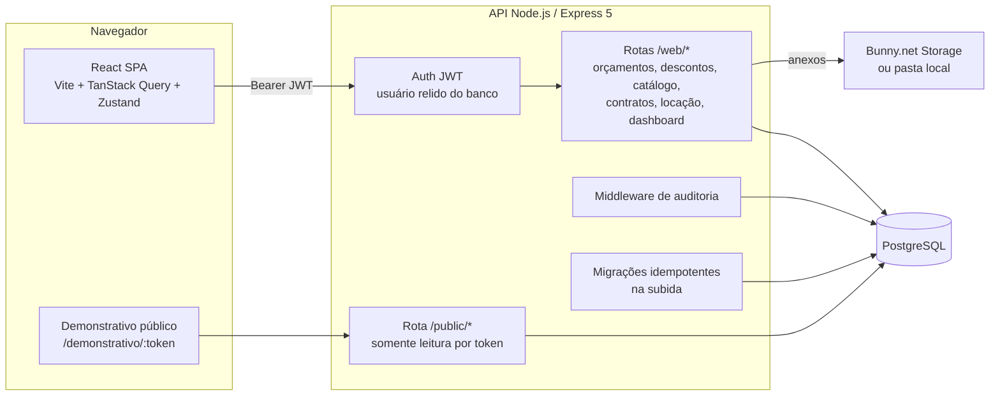

# Orça Eventos — orçamentos de formatura e locação de espaço

Sistema interno de uma empresa de eventos de formatura. O consultor monta o **orçamento da turma** (eventos como aula da saudade, colação de grau e festa de 50%, cada um com itens, quantidades e preços), o sistema calcula o total e o **valor por formando**, e o orçamento passa por um fluxo de **pedidos de desconto, aprovação, análise e versões** até virar **contrato e anexo contratual**. Um segundo produto, a **proposta de locação do centro de eventos**, usa uma tabela de preços própria, com versões e aprovação de desconto.

Por trás disso há um catálogo configurável pelo administrador (itens, eventos por cidade, auditórios), um link público de demonstrativo para a comissão de formatura, impressão em PDF com papel timbrado, painel com métricas e uma trilha de auditoria de todas as ações.

> **Sobre esta versão:** versão anonimizada de um sistema que construí e que roda em produção para uma empresa; nomes, marca, domínios, conteúdo proprietário e dados foram substituídos por fictícios. O catálogo, os preços, o modelo de contrato, as condições da proposta de locação e os percentuais de comissão são de demonstração. A arquitetura, as regras de negócio e o código são os do sistema real.

**English summary:** Internal quoting system for a graduation-events company (React 19 + TypeScript + Vite / Node.js + Express 5 + PostgreSQL). Sales consultants build per-class quotes from a configurable event/item catalog; the pricing engine computes event totals, admin fees and the per-student value. Quotes go through discount requests (percent or fixed amount, with attachments), manager approval, analyst review threads, edit-unlock requests and immutable versioning, and end as contracts and contract annexes. Also includes a venue-rental proposal module with a frozen price snapshot and versions, a public read-only quote link, printable layouts, a metrics dashboard, role-based permissions and a full audit trail. Runs locally with one `docker compose up`.

---

## Sumário

- [O que o sistema faz](#o-que-o-sistema-faz)
- [Arquitetura](#arquitetura)
- [Stack](#stack)
- [Rodar localmente](#rodar-localmente)
- [Contas de demonstração](#contas-de-demonstração)
- [Roteiro para testar](#roteiro-para-testar)
- [Integrações](#integrações)
- [Segurança](#segurança)
- [Testes](#testes)
- [Estrutura do repositório](#estrutura-do-repositório)
- [Variáveis de ambiente](#variáveis-de-ambiente)
- [Decisões técnicas](#decisões-técnicas)

---

## O que o sistema faz

### Orçamentos de formatura

| Módulo | O que faz |
|---|---|
| **Novo orçamento** | Assistente em 3 passos: dados da turma e escolha dos eventos (filtrados pela cidade), itens e valores de cada evento, e o resumo final. Os itens têm variações, sub-itens, quantidade derivada do número de formandos (igual, soma, multiplicação ou fixa) e preço editável ou travado, conforme o cadastro. |
| **Cálculo** | Total por evento, taxa de administração por evento, valor por formando e quadros de resumo acumulados, configuráveis por evento (por exemplo, "valor total até a festa"). O motor de cálculo roda no front e tem testes de regressão. |
| **Descontos** | Pedido de desconto geral ou por item, em percentual ou em valor fixo (R$), com anexo opcional. Quem tem a permissão aprova ou rejeita, podendo aprovar um percentual diferente do pedido. |
| **Aprovação e bloqueio** | Ciclo Pendente → Enviado para aprovação → Aprovado / Cancelado. Orçamento enviado ou aprovado fica bloqueado; para mexer, o consultor pede liberação e o gestor aprova. |
| **Análise** | O analista (perfil somente leitura) abre uma devolutiva; o criador responde que corrigiu; o analista aprova. Tudo fica num histórico por orçamento. |
| **Versões** | Cada orçamento tem um código de família. O original não muda: editar cria a versão seguinte. |
| **Demonstrativo público** | Link com token aleatório para a comissão ver o orçamento sem login, com botão de WhatsApp. |
| **Impressão** | Visão da equipe e visão do cliente, em dois layouts, com capa e papel timbrado. |
| **Arquivamento** | Administradores arquivam e desarquivam orçamentos. |

### Contratos

- **Contratos:** modelo com campos `{{variável}}` preenchidos na tela, com pré-visualização em papel timbrado.
- **Anexo contratual:** gerado só para orçamento aprovado, um por família. Aceita eventos-cortesia que não mudam o orçamento, e as alterações feitas no anexo geram uma nova versão do orçamento.

### Proposta de locação do espaço

- Tabela de preços editável pelo gestor: entradas/setores, opcionais com valor fechado ou por diária, climatização na montagem, diárias extras e validade.
- A proposta guarda os preços usados (snapshot): mudar a tabela depois não altera proposta já emitida.
- Desconto com aprovação na própria tela, ciclo de status, versões e impressão em 4 páginas.

### Gestão

- **Dashboard:** métricas, gráfico por mês ou por dia, filtros por período, status, arquivados e consultor. Inclui os números das propostas de locação.
- **Comissões:** comissão do consultor sobre orçamentos e propostas aprovados no mês.
- **Catálogo:** itens, sub-itens, eventos por cidade (com famílias de eventos, clonar para outra cidade e "aplicar às outras cidades"), auditórios por cidade e cidades.
- **Usuários:** 4 perfis (master, gerente, consultor, analista) e 9 permissões individuais.
- **Logs:** trilha de auditoria das requisições da API, com filtros e, nas ações principais, antes/depois e diferença campo a campo.
- **Aviso de versão nova:** o front compara a própria versão com `/version.json` e avisa quando há deploy novo.

---

## Arquitetura



**Fluxo principal**

1. O consultor escolhe os eventos e preenche os itens. O front calcula os totais com o catálogo vindo da API (`/web/event-templates/runtime-catalog`) e grava o orçamento com o formulário inteiro (`form_data`) e os totais.
2. Se precisa de desconto, o pedido vai para a fila de **Aprovações**. O gestor aprova ou rejeita, e o orçamento recalcula.
3. O consultor envia para aprovação (o orçamento trava). O analista pode abrir devolutivas. O gestor aprova.
4. Com o orçamento aprovado, o administrador gera o anexo contratual e o contrato. A comissão recebe o link do demonstrativo.

**Envelope das respostas:** toda resposta da API vem como `{ payload: <JWT> }` com `{ boleano, obj, mensagem }` dentro. O front decodifica o payload. O envelope tem uma audiência JWT diferente da do token de sessão, então uma resposta nunca serve de credencial.

---

## Stack

**Frontend:** React 19, TypeScript 5.9, Vite 7, React Router 7, TanStack Query 5, Zustand 5, React Hook Form + Zod 4, Recharts, Sonner, Lucide, CSS Modules. Testes com Vitest.

**Backend:** Node.js 20+, Express 5, PostgreSQL (`pg`), jsonwebtoken, bcryptjs, multer, express-rate-limit. SQL escrito à mão, sem ORM.

**Infra:** Dockerfiles (a imagem da API roda sem root) e `docker-compose` para o ambiente local. Em produção roda numa VPS com deploy por GitHub Actions; essa parte foi retirada deste repositório. O workflow que ficou (`.github/workflows/ci.yml`) só compila e testa.

---

## Rodar localmente

### Opção 1: Docker (recomendado)

Pré-requisito: Docker Desktop.

```bash
git clone https://github.com/vitormouramaker/event-quote-platform.git
cd event-quote-platform
docker compose up --build
```

- Front: http://localhost:5180
- API: http://localhost:4444/health

Na subida, o compose cria as tabelas, as [contas de demonstração](#contas-de-demonstração) e o catálogo de eventos (só se o banco estiver vazio).

### Opção 2: Sem Docker

Pré-requisitos: Node.js 20+ e PostgreSQL 14+ rodando localmente.

```bash
# 1. Banco
createdb -U postgres event_quote

# 2. API
cd backend
cp .env.example .env          # ajuste DB_USER / DB_PASS / DB_PORT se precisar
npm install
npm run seed:demo             # cria as tabelas e as contas de demonstração (senha Demo@2026)
npm run seed:catalog          # catálogo de eventos e itens (fictício)
npm run dev                   # http://localhost:4444

# 3. Front (outro terminal)
cd frontend
npm install
npm run dev                   # http://localhost:5173
```

O front usa `http://localhost:4444` por padrão e, se a porta estiver ocupada, procura a API sozinho nas portas 4445 a 4449 (a API faz o mesmo ao subir). Para apontar para outra API, crie `frontend/.env.local` com `VITE_API_URL`.

### Sem chaves externas, tudo funciona

| Sem... | Comportamento |
|---|---|
| `BUNNY_*` | Os anexos dos pedidos de desconto ficam na pasta `backend/uploads` e são servidos pela própria API em `/uploads`. |
| `VITE_WHATSAPP_NUMBER` | O botão do demonstrativo usa um número fictício. |

---

## Contas de demonstração

Criadas por `npm run seed:demo` (ou automaticamente no Docker). O campo de acesso é o **login** (não é e-mail). Senha de todas: **`Demo@2026`**. As contas existem só no seu banco local, e o script se recusa a rodar com `NODE_ENV=production`.

| Login | Perfil | O que pode |
|---|---|---|
| `admin` | Master | Tudo, inclusive usuários e catálogo |
| `gerente` | Gerente | Aprova descontos e liberações, vê dashboard, comissões, anexos e logs, edita o catálogo |
| `consultor` | Consultor | Cria e edita os próprios orçamentos, pede desconto e liberação, cria propostas de locação e contratos |
| `analista` | Analista de orçamento | Vê todos os orçamentos (somente leitura) e registra devolutivas |

## Roteiro para testar

1. Entre como **consultor** e crie um orçamento: escolha a cidade "Capital", marque dois ou três eventos (por exemplo, aula da saudade e colação de grau), informe o número de formandos e veja o valor por formando mudar.
2. Peça um desconto em um item (em % ou em R$, com um PDF anexado) e salve.
3. Em outra janela anônima, entre como **gerente**, abra **Aprovações** e aprove o desconto com um percentual diferente. Volte ao consultor e veja o orçamento recalculado.
4. Como consultor, envie o orçamento para aprovação: ele trava. Peça liberação para editar; o gerente aprova em **Aprovações**.
5. Entre como **analista**, abra o orçamento e registre uma devolutiva. O consultor responde e o analista aprova.
6. Como gerente, aprove o orçamento, gere o **anexo contratual** e imprima nas visões equipe e cliente. Gere o link do **demonstrativo** e abra numa janela anônima.
7. Abra **Propostas de Locação**, monte uma proposta com opcionais e desconto, e depois mude a tabela de preços (como gerente) para ver que a proposta antiga não muda.
8. Como **admin**, veja **Logs** para a trilha completa do que foi feito, com antes e depois.

---

## Integrações

### Bunny.net Storage (anexos)

- Upload pela Storage API e leitura pela CDN, com nome de arquivo UUID.
- Opcional: sem as variáveis `BUNNY_*` o arquivo vai para uma pasta local servida pela API.
- Tipos aceitos: PDF, DOC/DOCX, JPG/PNG e XLS/XLSX, até 10 MB.

### WhatsApp

- O demonstrativo público tem um botão `wa.me` com mensagem pronta (o número vem de `VITE_WHATSAPP_NUMBER`).

---

## Segurança

- Senhas com **bcrypt**. Hashes MD5 antigos (sem sal) ainda são aceitos uma vez e regravados em bcrypt no login.
- `JWT_SECRET` obrigatório (mínimo 32 caracteres): sem ele a API não sobe.
- O token de sessão só prova quem é o usuário. Papel, permissões e conta ativa são **relidos do banco a cada requisição**: desativar alguém ou tirar uma permissão vale na hora.
- Token de sessão e envelope de resposta usam audiências JWT diferentes, então uma resposta assinada (inclusive a do link público) não vale como token.
- Autorização em cada rota: o consultor só vê os próprios orçamentos e os pedidos ligados a eles; só quem tem a permissão aprova descontos e liberações; o catálogo só é alterado por administradores; quem só gerencia usuários não cria nem altera um master.
- Rate limit no login, CORS com lista de origens, `x-powered-by` desligado, SQL sempre parametrizado.
- A trilha de auditoria mascara campos de senha e token.
- O link público usa token aleatório de 192 bits e não expõe ids internos de usuário.

---

## Testes

```bash
cd frontend && npm test          # 181 testes (Vitest): motor de cálculo, descontos, impressão, versões, locação
cd backend && npm run test:smoke # teste de fumaça contra a API rodando: login, permissões e fluxos principais
```

O teste de fumaça faz 7 logins; com o limite padrão (10 por IP a cada 15 minutos), rode-o uma vez por subida da API ou aumente `LOGIN_RATE_LIMIT`.

---

## Estrutura do repositório

```
event-quote-platform/
├── docker-compose.yml           # Postgres + API + front para rodar local
├── .github/workflows/ci.yml     # build e testes (sem deploy)
├── backend/
│   ├── src/
│   │   ├── app.js               # bootstrap, CORS, rotas, healthcheck
│   │   ├── security/auth.js     # senha, JWT, middleware e regras de permissão
│   │   ├── middleware/          # trilha de auditoria
│   │   ├── routes/              # auth, users, budgets, discounts, edits,
│   │   │                        # budget-reviews, items, sub-items, event-templates,
│   │   │                        # auditoriums, cities, contracts, contract-annexes,
│   │   │                        # venue-proposals, dashboard, logs, public
│   │   ├── models/              # SQL das consultas
│   │   ├── services/            # execução das consultas, auditoria, armazenamento
│   │   ├── server/connect.js    # pool do Postgres e migrações idempotentes
│   │   └── scripts/             # seed das contas de demonstração e do catálogo
│   └── test/smoke.js            # teste de fumaça da API
└── frontend/
    ├── scripts/                 # gera o catálogo canônico (JSON) a partir do TypeScript
    └── src/
        ├── features/            # um diretório por domínio: budgets, venueProposals,
        │                        # contracts, annexes, items, events, dashboard,
        │                        # commissions, users, logs...
        ├── components/          # botão, input, modal, tabela, paginação...
        ├── services/api.ts      # cliente HTTP, descoberta da API local, envelope JWT
        ├── store/               # Zustand (sessão, pedidos de desconto)
        └── layout/              # menu lateral e layout
```

---

## Variáveis de ambiente

### Backend (`backend/.env.example`)

| Variável | Para quê | Obrigatória localmente |
|---|---|---|
| `DB_HOST`, `DB_PORT`, `DB_NAME`, `DB_USER`, `DB_PASS`, `DB_SSL` | Conexão com o PostgreSQL | sim (o exemplo já funciona) |
| `JWT_SECRET` | Assinatura dos tokens (≥ 32 caracteres) | sim (o exemplo já funciona) |
| `PORT` | Porta da API (padrão 4444; se ocupada, tenta as 5 seguintes) | não |
| `CORS_ORIGINS` | Endereços do front liberados, separados por vírgula | não |
| `PUBLIC_API_URL` | Monta a URL dos anexos gravados localmente | não |
| `LOGIN_RATE_LIMIT` | Tentativas de login por IP a cada 15 minutos (padrão 10) | não |
| `BUNNY_ACCESS_KEY`, `BUNNY_STORAGE_ZONE`, `BUNNY_STORAGE_HOST`, `BUNNY_CDN_BASE`, `BUNNY_FOLDER` | Anexos no Bunny.net | não |
| `UPLOADS_DIR` | Pasta dos anexos quando o Bunny.net não está configurado | não |
| `SEED_FILE` | Caminho do catálogo canônico para o seed | não |
| `API_DEBUG` | `1` liga o log detalhado de cada requisição | não |

### Frontend (`frontend/.env.example`, lidas no build)

| Variável | Para quê |
|---|---|
| `VITE_API_URL` | Endereço da API (padrão `http://localhost:4444`) |
| `VITE_WHATSAPP_NUMBER` | Número do botão de WhatsApp do demonstrativo |
| `VITE_APP_ENV` | `homolog` mostra a faixa "Ambiente de homologação" |

---

## Decisões técnicas

- **Migrações idempotentes no código** (`server/connect.js`). A cada subida, o schema é conferido e completado (`CREATE ... IF NOT EXISTS`, `ADD COLUMN IF NOT EXISTS`, enum e constraints só quando faltam). Um banco vazio e um banco de produção antigo chegam ao mesmo estado.
- **Catálogo canônico em TypeScript.** Eventos, itens, regras de quantidade e de preço e linhas de resumo estão em `canonicalCatalog.ts`. Um script gera o JSON que o backend usa no seed, e o front usa a mesma definição como configuração padrão do motor de cálculo. Uma fonte só, tipada.
- **Cálculo no front, com testes.** O orçamento recalcula a cada tecla e precisa ser idêntico na tela, na impressão e no demonstrativo. Por isso o motor é uma camada de domínio pura (`features/budgets/domain`), coberta por testes de regressão.
- **Desconto em valor fixo sem quebrar o legado.** O pedido em R$ grava o modo e o valor exato. O percentual equivalente continua nas colunas antigas, para todo relatório existente seguir funcionando.
- **Versões em vez de edição.** Orçamento enviado ou aprovado e proposta de locação emitida não são reescritos: editar cria a versão seguinte da mesma família. A proposta guarda o snapshot dos preços.
- **Auditoria por middleware.** Toda requisição às rotas `/web/*` vira um registro com quem, o quê, status, duração e, nas rotas que informam, antes, depois e a diferença campo a campo.
- **Permissão relida a cada requisição.** Custa uma consulta por chamada, e em troca a revogação de acesso é imediata.

---

Autor: [@vitormouramaker](https://github.com/vitormouramaker)

Licença: código exibido como portfólio, todos os direitos reservados.
